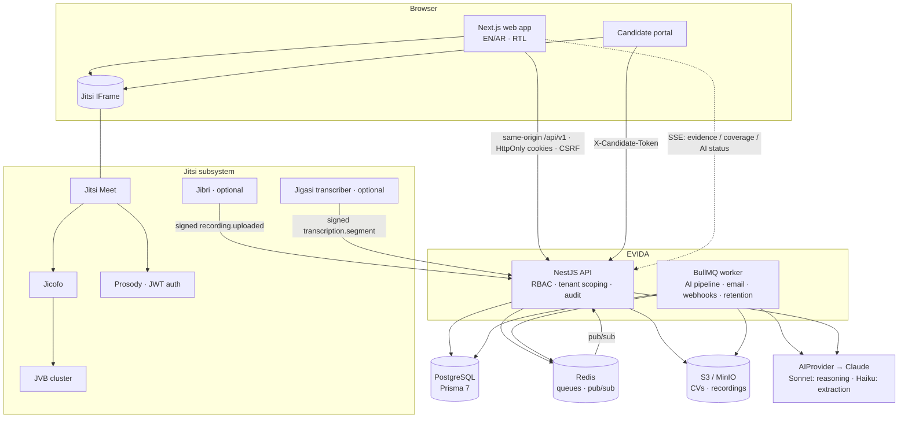
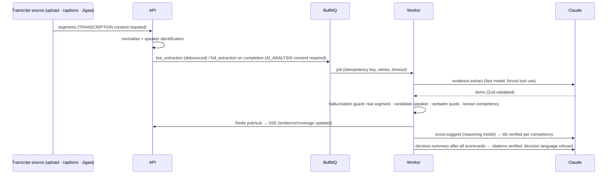

# Architecture

EVIDA is a **modular monolith**: one NestJS API process, one worker process (same codebase and image), PostgreSQL,
Redis/BullMQ, S3-compatible object storage, and a separately deployed Jitsi cluster. No microservices.

## Module map (`apps/api/src`)

| Area | Location | Responsibility |
|---|---|---|
| Auth | `modules/auth` | Register, password login with lockout, magic links/invitations, rotating refresh tokens with reuse detection |
| Organizations & users | `modules/org` | Org policy (blind review, recording, retention, consent version), invitations, roles, in-app notifications |
| Jobs, competencies, plans | `modules/jobs` | CRUD with optimistic locking, AI drafting (queued), human approval, immutable active plans |
| Candidates | `modules/candidates` | FTS search, secure CV upload, CV intelligence, pipeline stages, evidence profile, export/erasure |
| Interviews | `modules/interviews` | Scheduling + invitations, room (Jitsi JWT, SSE, copilot), transcript ingestion, evidence validation, scorecards |
| Decisions | `modules/decisions` | Decision view (scores, variance, coverage, gaps, AI summary), immutable human decisions |
| Candidate portal | `modules/portal` | Disclosure, granular consent + withdrawal, room access, own-mic captions, feedback |
| Analytics | `modules/analytics` | Dashboard KPIs incl. north-star metric, interview quality, coaching, fairness, AI usage; CSV reports |
| Governance & audit | `modules/governance` | AI Governance Center, audit log + CSV, AI job status |
| Integrations | `modules/integrations` | Outbound webhooks (HMAC, retries, DLQ), inbound Jitsi events (HMAC, replay window) |
| AI | `ai/` | `AIProvider` interface, Claude adapter, versioned prompt registry, Zod schemas, hallucination guard |
| Domain | `domain/` | Pure logic: evidence coverage, transcript parsing/speaker identification, consent state, quality metrics, blind review |
| Worker | `worker.ts`, `worker/` | Queue processors with timeouts, exponential backoff, idempotency keys, dead-letter queue, metrics |

## The interview case

`Application` (candidate × job) is the interview case. It links interviews (each bound to a plan stage), consent
records, transcripts and segments, evidence (each tied to a competency, a transcript segment and a timestamp),
scorecards with evidence-linked scores, the AI decision summary, the decision history and the audit trail.

## AI processing pipeline

## Evidence coverage (signature metric)

Per competency, validated evidence (confirmed / edited / interviewer-added) counts 1, unreviewed AI detections count
0.5 × confidence, rejected counts 0; coverage = min(1, Σ / 3). A competency is **Sufficient** only with coverage ≥ 0.8
**and** at least one human-validated item, so AI alone can never complete a competency. Overall coverage is the
weight-weighted mean. The **north-star metric** is the share of hire/offer/reject decisions recorded with no
unresolved competencies.

## Live updates

Workers publish `evidence.updated`, `coverage.updated`, `ai.status` events to `evida:<orgId>:interview:<id>` on
Redis; the API streams them over Server-Sent Events after tenant and assignment checks.

## Multi-tenancy

Every tenant-owned row carries `organizationId`. Every query is scoped in the service layer
(`AccessService`, explicit `where: { organizationId }`), cross-tenant lookups return 404, and interviewers are
further limited to interviews they are assigned to. Optional PostgreSQL RLS policies are in `infra/sql/rls.sql`.

## Roadmap

- **Phase 2:** Microsoft Entra ID / Google Workspace SSO, OIDC & SAML 2.0, MFA and passkeys, calendar (Outlook,
  Google), ATS adapters behind the webhook/integration boundary, candidate self-scheduling, custom competency
  libraries and templates, Arabic speech models for transcription.
- **Phase 3:** AI pre-screening, assessments, agency workspaces, data residency, private model deployments
  (implement `LocalLLMProvider`).
- Explicitly excluded: emotion recognition, facial analysis, personality inference, AI as decision maker.
