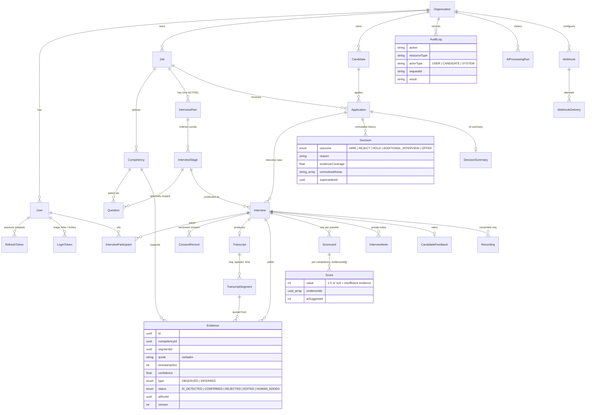

# Database ERD

PostgreSQL via Prisma 7 (`apps/api/prisma/schema.prisma`). UUID keys, `createdAt`/`updatedAt`, soft deletion for
users/jobs/candidates/files, optimistic `version` columns on jobs, plans, evidence and scorecards.
Database-level guarantees (migration `*_hardening`): `AuditLog` and `Decision` reject UPDATE/DELETE, score and
confidence range checks, a GIN full-text index on candidates.

